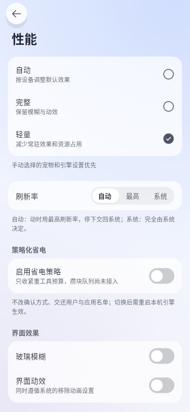

<p align="center">
  <b>简体中文</b> · <a href="README.en.md">English</a><br>
  <sub>英文版为上游原文，未包含本分支改动</sub>
</p>

<p align="center">
  <picture>
    <source media="(prefers-color-scheme: dark)" srcset="docs/assets/hero-zh-dark.webp">
    
  </picture>
</p>

<h3 align="center">DSH Go · 省电分支</h3>

<p align="center">
  <a href="https://github.com/ccch1mneyyy/dsh-Go">ccch1mneyyy/dsh-Go</a> 的个人 fork，在它之上收敛了两处耗电。
</p>

<p align="center">
  
  
  <a href="https://github.com/Kiastr/dsh-Go/actions/workflows/ci.yml"></a>
</p>

> **这不是官方版本。** 本仓库只用于自用构建：不发布 APK、不接收 PR、不改名不换素材。
> 下载、问题反馈与署名规则请回[上游仓库](https://github.com/ccch1mneyyy/dsh-Go)。

DSH Go 是 [DeepSeek Harness](https://github.com/deepseek-ai/deepseek-harness) 的 Android 客户端，能在手机上直接跑引擎，也能遥控电脑上的 DSH。完整的产品介绍在[上游 README](https://github.com/ccch1mneyyy/dsh-Go#readme)，**这里只讲本分支的差异**。

## 这个分支改了什么

上游的耗电问题分两层：一是引擎挂在后台时**根本不让 CPU 睡**，二是重工具**一跑就是 120 秒**。本分支一层一处，各对应一个 PR。上游政策不接受外部 PR，所以改动留在这里自用。

| # | 改动 | 层 | 行为差异 | 默认 |
| --- | --- | --- | --- | --- |
| 1 | 唤醒锁收敛 | L0：CPU 能不能睡 | 引擎空闲不再持 `PARTIAL_WAKE_LOCK`；状态轮询 2 s → 5 s | ✅ 生效 |
| 2 | 策略化省电 | L2：醒来后做多大 | 开启后重工具预算 120 s → 30 s | ⚪ 关闭 |

两处互补，不重叠：L0 决定「能不能睡」，L2 决定「醒了以后做多大」。两处改动合计 25 个文件、+963 / −13（不含本 README 的整理）。

### 1. 后台不再永久持有唤醒锁

**上游行为**：`DshService.kt` 在引擎一启动时就 `acquire()` 一把**没有超时**的 `PARTIAL_WAKE_LOCK`，只有 `onDestroy` 才释放。只要引擎活着，CPU 就不允许深睡，息屏后 Doze 也进不去。`PhoneControl` 另外每 2 秒做一轮状态检查。

**本分支**：

- 只有两个真实需要 CPU 常醒的原因才持锁——**安装解压**、**手机操控任务**；其余时间一律不持锁，让系统正常进 Doze。
- 新增 `WakeHoldGate` 状态机（纯 Kotlin，不依赖 `android.*`）：幂等、可重叠，等最后一个原因撤销才释放。
- `acquire(timeout)` 兜底：手机操控 15 分钟、安装 30 分钟。某条路径忘释放也不会整夜按住 CPU。
- 状态轮询 2 s → 5 s，并在三个事件点补一次立即检查（任务快照变化、任务结束、无障碍断连），把最坏延迟补回去。

**为什么这样够用**：前台服务 + 电池优化白名单已经负责保活，网络包到达由内核唤醒，不需要 App 自己举着 CPU。

**代价**：后台跑纯 CPU 密集、无网络活动的长任务时，息屏可能变慢。安装与手机操控仍持锁；真机上若发现别的场景被拖慢，给 `WakeHoldGate` 加一个 `Reason` 即可（重叠语义与穷举测试已覆盖）。

### 2. 策略化省电

<p align="center">
  
  <br>
  <sub>设置 › 性能 › 策略化省电（独立分组，默认关闭）</sub>
</p>

**问题**：`ANDROID_SHELL`、`COLLECT` 这类重工具单次预算是 120 秒。手机放在兜里时，它们照样按 120 秒跑满。

**本分支**：打开开关后，`PhoneCore.runCall()` 把**原预算超过 30 秒**的工具压到 30 秒。判据复用 `budgetMs(name)` 这一处真源，不在策略层另维护工具清单。关掉开关，行为与上游逐字一致。

**边界（重要）**：这一版只落地了**决策层 + 硬闸门**。`PowerPolicy.decide()` 的门控矩阵、护栏与攒块判据都有 JVM 单测，但**攒块执行器**（落盘队列、`JobScheduler`、连线恢复 flush）**还没接**，`DSH_POWER_MODE` / `DSH_POWER_MAX_TOOL_MS` 也只是注入引擎环境、引擎侧暂无消费点。所以开关打开后真正生效的只有重工具预算这一条，UI 文案也不宣称攒块已生效。

设计细节（决策矩阵、护栏、接入链路、key 对齐）见 [`docs/power-saver-strategy.md`](docs/power-saver-strategy.md)。

## 关掉与回退

| 想做的 | 做法 |
| --- | --- |
| 关掉策略化省电 | 设置 › 性能 › 策略化省电 → 关。重工具预算回到 120 s，需重启本机引擎 |
| 只退掉 L2 | `git revert -m 1 69d0dad` |
| 只退掉 L0 | `git revert -m 1 229fb26` |

两处都不改确认方式、交还用户与应用名单；L0 没有 UI 变化。

## 验证到什么程度

| 项 | 结果 |
| --- | --- |
| CI（`changes`、`Flutter 0/1/2`、`Android JVM`、`CI OK`） | ✅ 全绿 |
| JVM 单测 | ✅ `PowerPolicyTest` 15 例、`WakeHoldGateTest` 6 例（含 46,656 条事件序列穷举） |
| golden 基准图 | ✅ 4 张随页面变化重出，目视核对中英文 / 明暗，无溢出 |
| **真机与 `batterystats`** | ❌ **未做**（没有设备） |

L0 的收益只能真机测，方法：

```bash
adb shell dumpsys batterystats --reset
# 熄屏放置 30 分钟以上，不动手机
adb shell dumpsys batterystats | grep -i -A5 'Wake lock'
adb shell dumpsys power | grep -i -E 'mWakefulness|WakeLock'
```

看 **Partial Wakelock 持有时长** 与 **Doze 深度休眠占比**。预期是 Partial Wakelock 从「整夜持有」降到接近 0。

## 构建

仓库不提供 APK。按上游的构建说明自己出包（Linux x86_64）：

```bash
git clone https://github.com/Kiastr/dsh-Go.git
cd dsh-Go

bash tooling/setup-toolchain.sh
source tooling/env.sh
bash runtime/build-runtime.sh arm64-v8a
DSH_BETA_TOKEN_FILE= bash tooling/build-apk.sh -f arm64 --keep-daemon
```

产物是 `app/build/app/outputs/flutter-apk/app-arm64-release.apk`。未配置 `app/android/key.properties` 时用 debug 签名，**不能覆盖安装官方包**，请装在测试设备上。工具链细节、x86_64 与发布签名见[上游「从源码构建」](https://github.com/ccch1mneyyy/dsh-Go#从源码构建)。

只想要一个能用的 APK，装[上游 Releases](https://github.com/ccch1mneyyy/dsh-go/releases/latest) 的版本即可，只是不含上面两处改动。

## 与上游同步

上游更新很快，本分支只维护这两个改动，其余一律跟随上游：

```bash
git remote add upstream https://github.com/ccch1mneyyy/dsh-Go.git   # 只需一次
git fetch upstream
git merge upstream/main        # 冲突优先保留上游
git push origin main
```

两边都动过 `PhoneControl.kt` 与 `DshService.kt`，冲突多半落在这两个文件；`WakeHoldGate.kt`、`PowerPolicy.kt` 是新增文件，一般不冲突。

## 上游的其他能力

本分支不改产品功能：本机运行、远程连接、聊天与工具、插件界面、手机操控、分享与主题都来自上游，行为一致。能力清单、安装要求、权限与数据说明见[上游 README](https://github.com/ccch1mneyyy/dsh-Go#readme) 与[使用指南](docs/guide/README.md)。

## 目录

| 路径 | 内容 |
| --- | --- |
| `app/` | Flutter 界面与 Android Kotlin 平台实现（本分支改动集中在 `performance/`、`runtime/`、`phone/`） |
| `packages/dsh_client/` | DSH Web API 的 Dart 客户端 |
| `packages/dsh_remote/` | DSH Remote 的 Dart 客户端 |
| `runtime/` | Linux 运行时打包、引擎补丁与 App 桥接 |
| `sdk/plugin-kit/`、`examples/plugins/` | 插件工具包与示例 |
| `docs/guide/`、`docs/plugins/`、`docs/pets/`、`docs/live2d/` | 用户指南、插件开发、宠物包与 Live2D 制作 |
| `docs/power-saver-strategy.md` | **本分支的省电设计文档**（决策矩阵、护栏、接入链路、边界） |
| `tooling/` | 工具链、APK 构建与诊断脚本 |
| `services/`、`site/`、`infra/` | 配套分享服务、网站和部署材料 |

## 风险

DSH Go 是社区开发的非官方客户端，与 DeepSeek 无关联。AI 会出错，工具会产生真实影响：命令、文件修改与手机操控都可能导致数据丢失或隐私泄露；免确认与「解除限制」会减少保护。请保留默认保护，只授予必要权限，不在存有支付信息的设备上解除限制。完整免责声明见[上游 README](https://github.com/ccch1mneyyy/dsh-Go#风险提示与免责声明)。

本分支额外提醒两点：**L0 让引擎空闲时不再持锁**，后台纯计算任务可能变慢；**L2 只收紧预算、不降安全档**，确认方式与应用名单一律不动。

## 许可与署名

代码以 [AGPL-3.0](LICENSE) 发布，`sdk/`、`examples/` 为 MIT，均来自上游。本分支是同一许可证下的修改版：保留原版权与许可声明，并在此标注修改。

- 主仓库：<https://github.com/ccch1mneyyy/dsh-Go>
- 原作者：[ccch1mneyyy](https://github.com/ccch1mneyyy)
- 修改：本分支的两处省电改动（见上）

DSH Go 的名称、标识，以及 Deepy、鲸娘形象不在 AGPL 授权范围内，条款见 [ASSETS.md](ASSETS.md)。本分支不发布 APK、不改名、不换素材，仅作自用构建。

<br>

<p align="center"><sub>DSH Go 是社区开发的非官方客户端，与 DeepSeek 没有关联，也不代表 DeepSeek。</sub></p>
